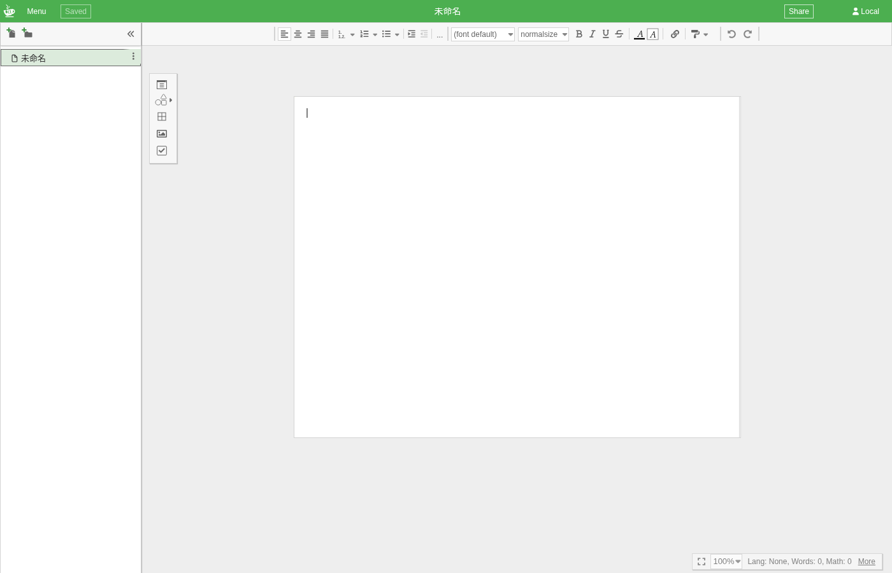
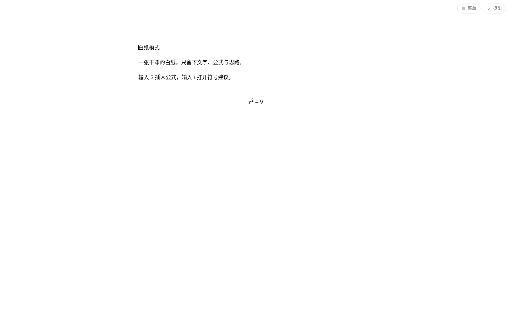
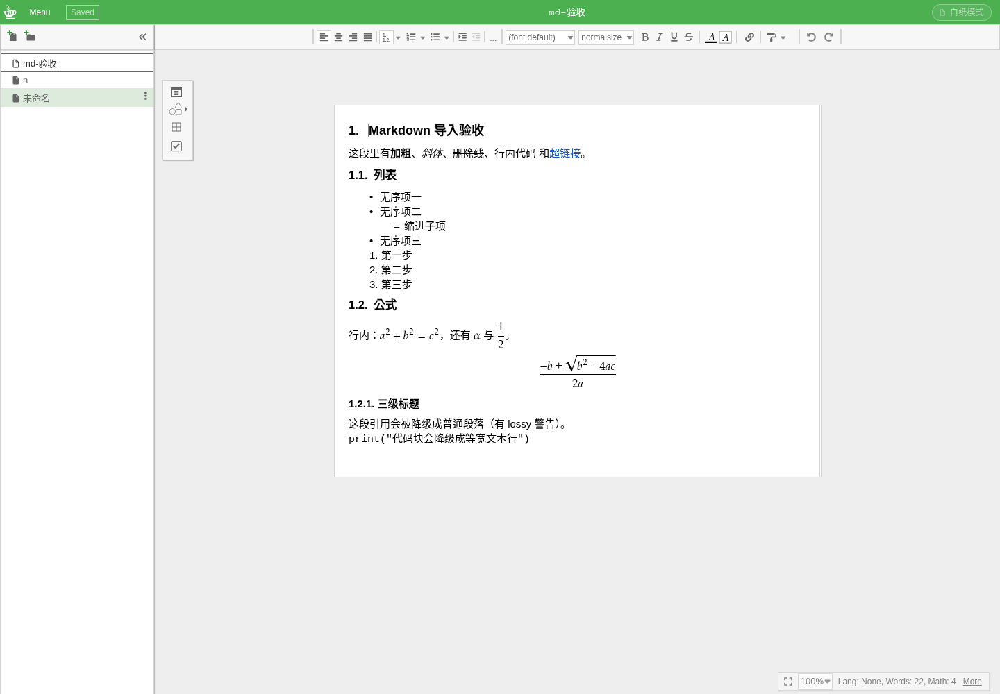

# Mathcha offline

Mathcha 网页编辑器的**本地离线源码仓库**：资源随仓库提供，运行期不联网，起服务只要一条 `npm run dev`。

```bash
npm run dev        # 或 pnpm dev → http://127.0.0.1:7801/editor（自动开浏览器）
```

不联网、不用 `npm install`、不用下载资源。需要 Node 18+（跑脚本）和 Python 3.8+（服务端，只用标准库）。



## 快速开始

```bash
npm run dev             # http://127.0.0.1:7801/editor；自动打开浏览器
npm start               # 同上，但不开浏览器
npm run dev -- 8080     # 换端口（也可以 ./start.sh 8080）
npm test                # 完整性检查 + 端到端冒烟（不需要浏览器）
```

pnpm 用法相同：`pnpm dev`、`pnpm test`。

## npm 脚本

| 脚本 | 作用 |
|---|---|
| `npm run dev` | 起本地服务并打开浏览器（默认 7801 端口） |
| `npm start` / `npm run serve` | 只起服务，不开浏览器 |
| `npm test` | 资源完整性 + Python 语法 + Markdown 自检 + 端到端冒烟（起临时服务拉关键接口） |
| `npm run check` | 同上，但不跑冒烟 |
| `npm run fetch` | 联网从 Mathcha CDN 升级/补全离线资源到 `assets/`（唯一联网的步骤） |
| `npm run unpack` | 把 `assets/` 里的压缩 bundle 还原成可读源码 → `src/mathcha/modules/`（需要先 `npm install` 装 Babel，仅开发用） |
| `npm run md:import -- notes.md --name 我的笔记` | Markdown 导入为编辑器文档（服务需在跑） |
| `npm run md:export -- <docId> -o notes.md` | 文档导出为 Markdown |
| `npm run md:list` | 列出文档 id / 名字 |
| `npm run clean` | 清理 `__pycache__` / `.logs`（不动 `data/` 里的文档） |

## 目录结构

```
mathcha-local/
├── package.json       # npm/pnpm 脚本入口（无运行期依赖）
├── src/
│   ├── server.py      # 本地 HTTP 服务：静态资源 + CSP + 注入 + 定点补丁
│   ├── api.py         # 本地 /api 实现（文档存 data/store.json）
│   ├── md/            # Markdown ↔ 模型转换器（convert.py）与自检（selftest.py）
│   ├── web/           # 本地前端扩展：白纸模式、#1/#2/#3 标题命令
│   ├── manifests/     # 离线资源三张清单（assets / chunks / cas-assets）
│   └── mathcha/       # 上游 bundle 还原出的 1416 个可读模块（阅读/定位用，运行时不加载）
├── assets/            # 离线资源：editor.html + cdn/**（字体、bundle、chunk、worker、CAS 引擎）
├── tools/             # dev/check/smoke/unpack/fetch 等脚本（Node 启动器 + Python 工具）
├── data/store.json    # 你的文档（唯一需要备份的文件；首次启动自动创建）
├── docs/              # 说明文档（CAS、白纸模式、Markdown、逆向分析笔记 docs/re/）
├── screenshots/
└── start.sh           # 兼容入口，等价于 npm run dev
```

## 白纸模式

点右上角「白纸模式」，或直接打开 `http://127.0.0.1:7801/editor?paper=1`。
`Alt+Shift+E` 也能进出；退出点右上角「退出」或双击 `Esc`。详见 [docs/paper-mode.md](docs/paper-mode.md)。



## Markdown 导入 / 导出



Markdown 可以直接导成编辑器文档，文档也能导回 Markdown（**序列化层，模型里不存 Markdown 原文**）：

```bash
npm run md:import -- notes.md --name "我的笔记"    # 导入（服务需在跑；刷新页面即可看到）
npm run md:list                                    # 列文档，拿 docId
npm run md:export -- <docId> -o notes.md           # 导出
python3 src/md/convert.py check notes.md           # 只转换、看统计和降级警告
```

支持：3 级标题（`#` 或 LaTeX 风格 `\title1` / `\section{…}`）、有序/无序列表（嵌套）、粗体/斜体/删除线/行内代码/链接、行内与块级公式（LaTeX 子集）。
在编辑器里，**正文空行行首**敲 `#1` / `#2` / `#3` 可直接生成层级标题（`src/web/title-command.js`，重启服务后生效）。
代码围栏 / 引用 / 表格 / 图片先降级为文本或链接并给出 `lossy:` 警告（不静默丢弃）。
详见 [docs/markdown.md](docs/markdown.md)，字段依据见 [docs/re/data/md-encoding.json](docs/re/data/md-encoding.json)。

## 离线资源（assets/）

仓库自带 `assets/`：`editor.html` + `cdn/**`（资源清单 121 条、去重后 97 个文件，约 30 MB：
主 bundle、样式、51 个数学字体、25 个懒加载 chunk、2 个 worker、手绘识别模型、CAS 的 Pyodide+SymPy）。
运行期只读它，缺了直接 404 并记 `data/cache-misses.log`，不会联网回源（CSP `connect-src 'self'` 也拦外网）。

- 升级编辑器版本：`npm run fetch`（联网一次，会覆盖 `assets/`；`--force` 强制重下）
- 完整性自查：`npm run check`

## 上游编辑器源码（还原）

`assets/` 里的编辑器是压缩过的单行 webpack 产物；仓库另外存了一份**还原成可读模块**的版本：
`src/mathcha/`（1416 个合法 CommonJS 文件 + 索引）。用途是读代码、搜符号、给本地补丁定位；
**运行期不加载它**，编辑器仍加载 `assets/` 的原 bundle。重新生成：`npm install && npm run unpack`
（细节见 [src/mathcha/README.md](src/mathcha/README.md)）。

## 功能

| 功能 | 说明 |
|---|---|
| **文本编辑** | 字体 / 字号 / 加粗斜体下划线 / 颜色 / 对齐 / 列表 / 缩进 / 章节 / 目录 / 定理环境 / 脚注 / 超链接 |
| **数学公式** | 所见即所得输入 LaTeX：分式、根号、上下标、积分与求和、矩阵/数组/分段、自动伸缩括号、输入建议框、符号/结构快捷键 |
| **CAS（计算机代数系统）** | 选中公式 → 浮动工具条的 fx → 33 个 SymPy 操作（化简 / 因式分解 / 求导 / 积分 / 极限 / 求和 / 解方程 / 矩阵运算）；结果插回文档，可继续编辑、导出。详见 [docs/cas.md](docs/cas.md) |
| **表格** | 增删行列、合并单元格、边框、对齐 |
| **图形** | 形状 / 箭头 / 直线曲线 / 坐标轴类工具 / 交换图（可导出 TikZ） |
| **多文档** | 新建、切换、重命名、删除（侧边栏） |
| **保存** | 自动保存 + `Ctrl+S`，重开恢复；数据在 `data/store.json` |
| **导出** | SVG / PNG / PDF / TikZ / LaTeX / `.mathcha` / HTML(zip)，全部在前端完成 |
| **打印** | 菜单里的 Print（可另存为 PDF） |
| **白纸模式** | 一键把界面收成一张干净白纸：隐藏 header / 侧栏 / 工具栏 / 插入条 / 缩放条，整屏刷白；入口：右上角「白纸模式」按钮、`Alt+Shift+E`、`?paper=1`；退出：右上角「退出」、`Alt+Shift+E`、双击 `Esc`。写作 / 公式 / CAS / 自动保存照常，文档管理与导出走右上角「菜单」。详见 [docs/paper-mode.md](docs/paper-mode.md) |
| **外观** | 深色模式、缩放 |

## 数据

| 项 | 位置 |
|---|---|
| 你的文档 | `data/store.json`（纯 JSON） |
| 接口日志 | `data/api.log`（仅方法/路径/长度） |
| 缺资源记录 | `data/cache-misses.log` |
| 离线资源 | `assets/`（随仓库提供；`npm run fetch` 可升级） |
| 还原源码 | `src/mathcha/`（阅读/定位用，不参与运行） |

- **备份**：复制 `data/store.json` 或整个 `data/`。
- **清空**：删掉 `data/store.json`，下次启动自动建空文档。
- **换机器**：整个仓库拷走即可（含 `assets/`，不需要重新下载）。

## 排查

| 现象 | 处理 |
|---|---|
| 启动提示"离线资源缺失" | 仓库里的 `assets/` 不完整：`npm run fetch` 补全，或重新克隆 |
| 页面 404 某个 `/cdn/...` | 看 `data/cache-misses.log`，再 `npm run fetch` 补齐 |
| 样式 / 字体异常 | `npm run fetch -- --force` 重新下载 `assets/` |
| 白纸模式入口没出现 / 进入后还是灰底 | 重启 `npm run dev`（旧进程不会注入 `src/web/paper-mode.*`）；再看浏览器控制台里 `/web/paper-mode.css` 是否 404 |
| 选公式点 fx 面板一直转圈 / 报 `Could not initialize CAS worker` | `npm run fetch` 补 CAS 资源（约 11 MB）；还缺就看 `data/cache-misses.log` 里缺哪个 `/resources/pyodide/...` |
| 某个 CAS 运算失败 | 看操作卡片底部的红条（SymPy 报错摘要），点 Details 看完整 traceback。常见原因：选区不是数学公式 / 不是矩阵却跑矩阵操作 / 方程没有解析解 |
| 文档打不开 | `python3 -m json.tool data/store.json` 检查 JSON |
| `npm run md:import` 报连不上服务 | 先 `npm run dev`；或加 `--offline` 直接写 `data/store.json`（服务运行期间别用 `--offline`） |
| 导入 Markdown 时看到 `lossy:` | 正常降级提示（代码块/引用/表格/图片/H4+），不丢内容，详见 [docs/markdown.md](docs/markdown.md) |
| 提示找不到 Python 3 | 装 Python 3.8+；或用 `MATHCHA_PYTHON=/path/to/python3 npm run dev` 指定解释器 |

## 合规

用 Mathcha 公开发布的前端代码在本机跑一个纯离线副本，**仅供个人本机使用**
需要官方离线版可购买 [Mathcha Notebook](https://www.mathcha.io/notebook/)。

CAS 引擎是 Pyodide（MPL-2.0）和 SymPy（BSD）的本地 wasm 副本，只随本机使用，不对外分发。

`src/mathcha/` 是从上游 bundle 还原出来的可读代码，版权归 Mathcha，仅用于本机研究/修改定位，
不构成任何授权。
