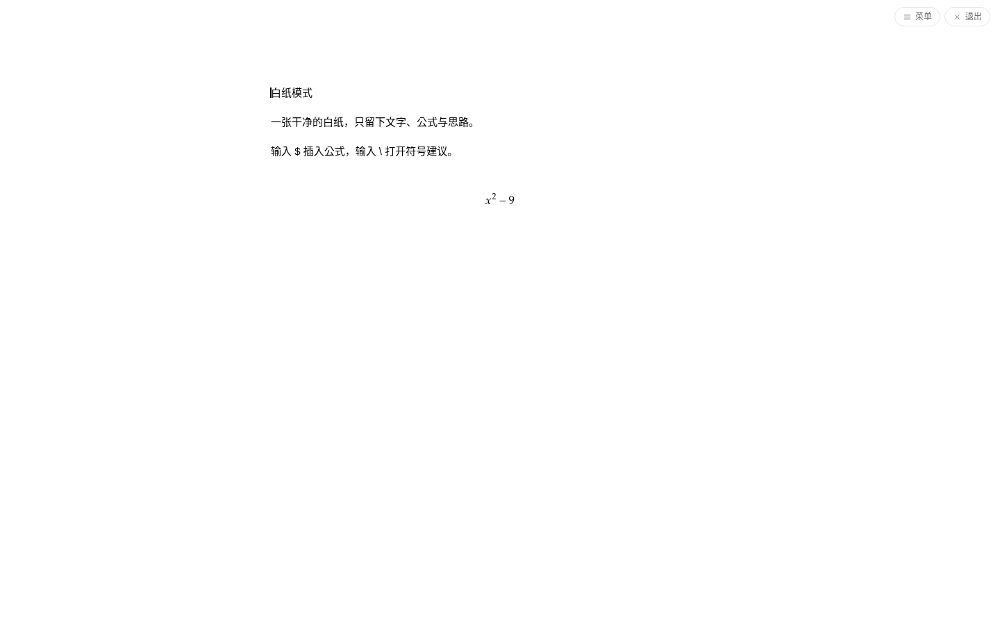
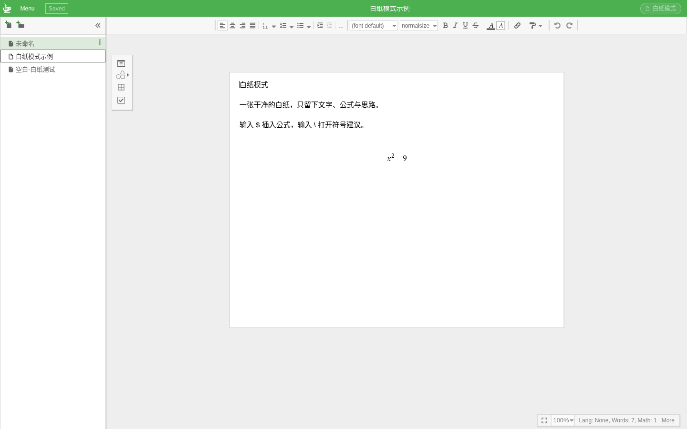
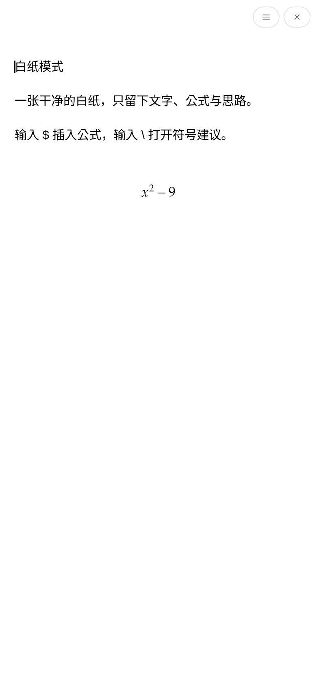

# 白纸模式（Paper Mode）

> 把 Mathcha 编辑器收成"一张干净的白纸"：整屏只留白色画布与可编辑内容，
> header、侧栏、工具栏、插入条、缩放信息条、页面描边全部藏起来；
> 同时保留输入、公式、CAS、自动保存等核心能力。
>
> 实现方式见 `src/web/paper-mode.css` 与 `src/web/paper-mode.js`（由 `src/server.py` 注入），不改上游 bundle。



<table>
<tr>
<td width="50%"></td>
<td width="50%"></td>
</tr>
<tr>
<td align="center">普通模式：右上角多一个「白纸模式」入口</td>
<td align="center">手机竖屏：纸张满宽、浮层收成图标</td>
</tr>
</table>

---

## 1. 进入方式

| 方式 | 操作 | 说明 |
|---|---|---|
| **入口按钮** | 普通模式右上角绿色 header 右侧的「白纸模式」胶囊 | 最直观；窄屏只显示图标 |
| **快捷键** | `Alt + Shift + E` | Mathcha 内置 Content View Only 的快捷键，被白纸模式接管（等价于进入/退出白纸模式） |
| **URL** | `http://127.0.0.1:7801/editor?paper=1`（也支持 `#paper`） | 做成浏览器书签即可"打开即白纸" |
| **记忆** | 上次退出时处于白纸模式，下次打开自动进入 | 存在浏览器 `localStorage`，不影响文档数据 |

> URL 参数优先级最高：`?paper=0` / `#normal` 只**本次**临时覆盖"自动进入"的记忆，不会改写记忆值（下次不带参数打开仍按记忆走）。
> 记忆存在浏览器本地：多个标签页共享同一份记忆，不同标签页各自切换会互相覆盖（这是有意的"最后选择生效"；当前页面 UI 不受影响）。

## 2. 退出方式

| 方式 | 操作 |
|---|---|
| 浮层按钮 | 右上角「✕ 退出」 |
| 快捷键 | `Alt + Shift + E` 再按一次 |
| 双击 Esc | 500 ms 内连按两次 `Esc`。单次 `Esc` 仍然是 Mathcha 自己的行为（关建议框 / 取消编辑 / 取消选择），所以不会误退；有建议框、对话框、右键菜单开着时，`Esc` 完全交给 Mathcha（需要时才连按两次退出） |
| URL | `?paper=0` / `#normal` |

退出后会恢复：绿色 header、文档侧栏、格式工具栏、缩放信息条、原主题（深/浅色）与**原光标位置**。

## 3. 白纸模式里还剩什么

**保留（核心功能）**

- 纸张本身：白底、可点击、可直接书写；光标/选区/复制粘贴/撤销重做/自动保存全部照常。
- 右上角一个极简浮层：**菜单**、**退出**（鼠标静止约 2.8 秒后自动淡出，动一下鼠标/触碰即回；触摸屏常显）。
- 所有功能浮层：`$` / `\` 的**符号建议框**、选中公式后的 **fx（CAS 面板）**、右键菜单、对话框、查找替换、表格/图形编辑条——一个都没动。
- 键盘快捷键（`Ctrl+S` 保存、`Ctrl+Z` 撤销、`Ctrl+B` 粗体、`$` 插入公式、`\` 打开符号建议……）。

**隐藏（减少干扰）**

- 绿色 header：logo / Menu / Saved / 文档名
- 左侧文档列表侧栏
- 顶部格式工具栏（字号、颜色、对齐、列表……）
- 左下插入工具条
- 右下缩放 + 内容视图信息条
- 页宽拖拽条、页面描边/阴影、滚动条装饰
- 背景灰底（整屏刷白，含深色模式）

**需要"完整界面"才能做的事**（点右上角「菜单」即可一键退出白纸模式并直接展开 Mathcha 完整菜单）

- 新建 / 切换 / 重命名 / 删除文档
- 导出（SVG/PNG/PDF/TikZ/LaTeX/HTML）、打印
- 需要工具栏的排版（字体、字号、颜色、对齐、列表、表格插行删列……）
- 外观设置、移动端视图切换

> 一句话：**白纸模式负责"写"**（文字、公式、CAS、保存），**菜单/完整界面负责"管"**（文档管理、导出、排版工具）。
>
> 常用的排版其实不用退出：`Ctrl+B` 粗体、`Ctrl+I` 斜体、`Ctrl+U` 下划线、`Ctrl+Z / Ctrl+Shift+Z` 撤销重做、`Ctrl+S` 保存、`Tab / Shift+Tab` 在公式槽位之间跳。

## 4. 空白状态下的操作入口

空白文档进入白纸模式时，纸面中央偏上会出现一句很淡的提示（不拦截鼠标、不遮挡书写）：

```
            点击纸张开始书写
$ 插入公式 · \ 打开符号建议 · Esc Esc 或 Alt+Shift+E 退出
```

- 提示只出现在**空文档**；一旦点击纸面、开始输入或再次进出模式，就淡出，同一会话内不再打扰。
- 纸张本身即可点击书写；进入白纸模式时光标会自动落在上次位置（空文档则放在首行）。
- 右上角浮层始终提供「菜单 / 退出」两个入口（淡出后可动鼠标唤回）。

## 5. 屏幕尺寸适配

| 宽度 | 表现 |
|---|---|
| **≥ 1024 px**（桌面） | 700 px 文档页宽水平居中（1440 宽窗口实测左右各 ≈370 px 留白）；内容顶部留白 ≈ 110–130 px（页面上边距 + 纸张内边距，≈ 9–12 vh）；右上角浮层按钮带文字（菜单 / 退出） |
| **600–1023 px**（平板/小窗） | 去掉 Mathcha 的 950 px 最小宽度限制，纸张贴合窗口；顶部留白收窄；浮层仍在右上角 |
| **≤ 599 px**（手机竖屏） | 纸张满宽（左右 18 px 内边距），顶部留白 ≈ 50 px；浮层收成图标按钮（☰ / ✕）常显；**不再出现横向滚动**（Mathcha 的 `.mt-sa` 覆盖层比纸张宽，已掐掉横向溢出；正文按容器宽度自动重排） |
| 任意宽度 | 纸张两侧留白自动随窗口变化；调整窗口后无需刷新，布局由 Mathcha 自己在 Content View Only 布局下重算 |

## 6. 实现原理（为什么这样实现）

1. **布局复用 Mathcha 内置的 Content View Only**（`state.fullScreen`，快捷键 `Alt+Shift+E`）：
   它会隐藏 header / 侧栏 / 工具栏并让内容区拉满、纸张居中，布局重算由上游自己完成，
   避免我们跟 React 抢内联样式（`docs-container` 的 `left/right/bottom`、`doc-scroll-container` 的 `height` 等每次 render 都会被重写）。
2. `src/web/paper-mode.js` 通过点击内置按钮（`.full-view-button` / `[title^="Exit Content View Only"]`）来切换这个布局；
   按钮被我们的 CSS 隐藏后仍然可以被脚本点击。按钮不可用时退回派发 `Alt+Shift+E` 键盘事件。
3. 切到该布局后，`src/web/paper-mode.css` 在 `html.paper-mode` 作用域内把一切刷白、藏掉残余 chrome：
   - `--ui-workspace: #fff`（Mathcha 的工作区底色变量，一处带走 html/body/#root/page/container-layer/content-area 的灰底）
   - 隐藏 `document-info-bar`、`resize-bar`、页宽拖拽条等
   - 深色主题下强制 `data-ui-theme="light"`，退出时恢复原主题
4. **状态同步**：每 120 ms 读一次"是否在 Content View Only"（只看 React 写下的痕迹：退出按钮的 title、`container-layer` 的内联 `height:100%`，**不看** header 的 computed display，避免被自己的 CSS 误导）。
   因此用户直接按 `Alt+Shift+E`（或点 Mathcha 自带的右下角内容视图按钮）时，白纸模式也会自动跟随，不会出现"模式状态脱节"。
5. **首帧不闪**：`src/server.py` 在 `</head>` 注入一小段内联脚本，在首帧之前就给 `<html>` 挂上 `paper-mode` 并把主题定为浅色；上游 `index.js` 稍后按自己的偏好写回深色时，会被 `MutationObserver` 在**同一次任务**里纠回浅色（退出时先摘 class 再恢复主题，所以观察器不会妨碍退出）。
   实测（深色偏好 + 上次白纸模式）：时间线 `106ms: 深色（应用尚未挂载）→ 115ms: paper-mode + 浅色`，之后不再回到深色；退出后恢复深色。
5. **焦点**：自绘按钮在 `mousedown` 上 `preventDefault()`，不抢编辑器焦点；进入后把焦点还给隐藏输入框并保持原光标，
   所以进入白纸模式后可以直接打字（不会丢字）。

## 7. 状态与数据

| 键 | 位置 | 作用 |
|---|---|---|
| `mathcha-local.paper-mode` | localStorage | 记住白纸模式开关（`"1"` / `"0"`） |
| `mathcha-local.paper-hint-dismissed` | sessionStorage | 本次会话内空白提示是否已被关掉 |
| `?paper=1` / `#paper` / `?paper=0` / `#normal` | URL | 临时强制进入/退出，优先于记忆 |

- **不写文档数据**：白纸模式只改界面状态，`data/store.json` 的内容格式与正常模式完全一致。
- 退出时会恢复原主题（深/浅色）与完整界面；刷新页面不丢文档。

## 8. 已知限制

- 需要工具栏的排版（字体/字号/颜色/对齐/列表）、文档管理、导出、打印，需要先退出白纸模式（右上角「菜单」一键退出并展开菜单）。
- 白纸模式会隐藏右下角的文档缩放控件；要缩放可用浏览器自带缩放（`Ctrl + +/-`）。
- 文档如果自带"暗色纸张"设置（`math-type.dark-mode`），白纸模式会把它翻成白底黑字；正文里**显式**设置的颜色不受影响。
- CAS 面板没有独立关闭按钮（上游行为：只能走面板齿轮菜单的 Close），退出白纸模式后同样如此。
- 记忆值存在 `localStorage`，多标签页共享；不同标签页各自切换会互相覆盖（最后选择生效）。
- 上游（Mathcha CDN）升级后 class/自定义元素名可能变化，需要复核 `src/web/paper-mode.css` 第 2.4 节的隐藏清单与 `paper-mode.js` 的探测逻辑。

## 9. 排查

| 现象 | 处理 |
|---|---|
| 右上角看不到「白纸模式」入口 | 刷新一次页面；确认 `src/server.py` 已重启（旧进程不会注入 `/src/web/paper-mode.*`） |
| 进入后仍是灰底/还有工具栏 | 浏览器控制台看 `/src/web/paper-mode.css` 是否 200；确认 `src/server.py` 是新版本 |
| 按 `Alt+Shift+E` 后界面没变白 | 说明注入脚本没加载（`/src/web/paper-mode.js` 404） |
| 想彻底关掉白纸模式 | `?paper=0` 打开一次，或 `localStorage.removeItem('mathcha-local.paper-mode')` |
| 想调整外观 | 直接改 `src/web/paper-mode.css`，刷新页面即可（`no-store`，不用重下资源） |
